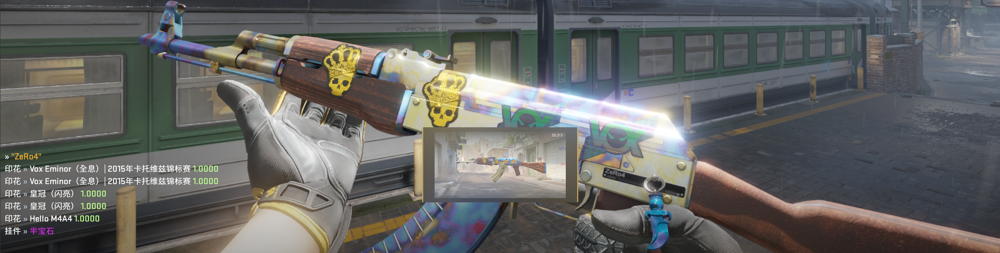
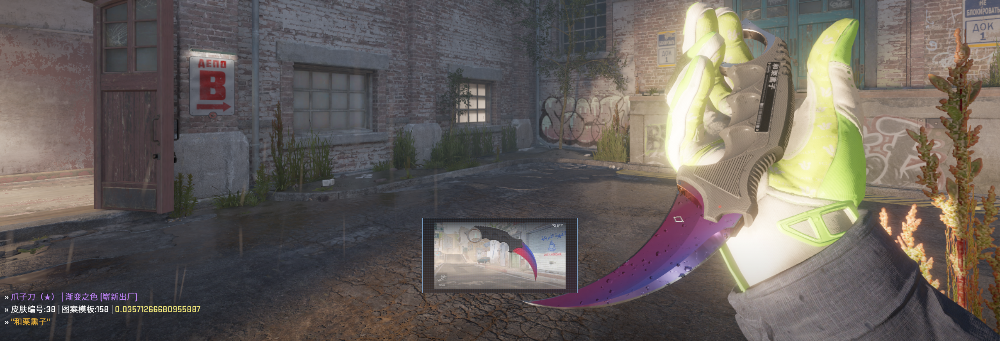

# BuffInspector

在 CS2 游戏内解析 BUFF 分享链接并更换皮肤。

## 使用方法

```text
!buff <BUFF 分享链接>
```

## 截图




## 依赖与构建

- .NET 10 SDK
- [SwiftlyS2 v1.4.14-beta.23](https://github.com/swiftly-solution/swiftlys2/releases/tag/v1.4.14-beta.23)
- [WeaponSkins v0.5.5](https://github.com/samyycX/WeaponSkins/releases/tag/v0.5.5)

```powershell
dotnet build BuffInspector.sln -c Release
```

将 `src/BuffInspector/bin/Release/net10.0/` 内文件复制到服务器的 `swiftlys2/plugins/BuffInspector/`。

## 许可证

[GPL-3.0](LICENSE)
